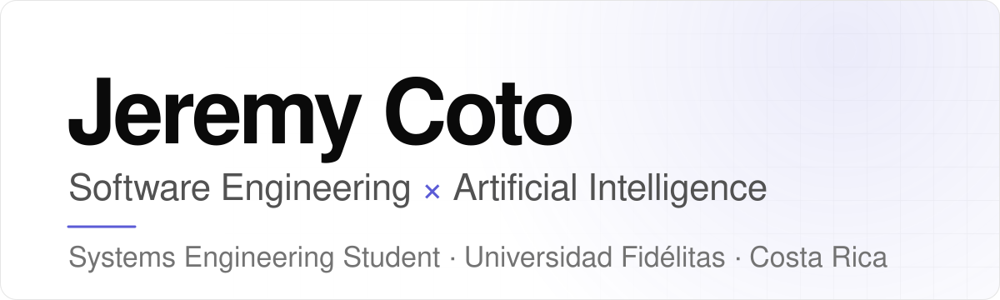
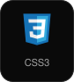
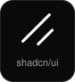
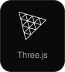
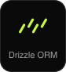
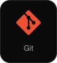
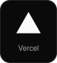
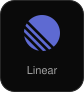

<picture>
  <source media="(prefers-color-scheme: dark)" srcset="./assets/header-dark.svg">
  <source media="(prefers-color-scheme: light)" srcset="./assets/header-light.svg">
  
</picture>

  <a href="#about">About</a> &nbsp;·&nbsp;
  <a href="#professional-focus">Focus</a> &nbsp;·&nbsp;
  <a href="#technology-stack">Stack</a> &nbsp;·&nbsp;
  <a href="#github-activity">Activity</a> &nbsp;·&nbsp;
  <a href="#areas-of-interest">Interests</a>

 

## About

I'm Jeremy Coto, a Systems Engineering student at Universidad Fidélitas in Costa Rica.

For about three years I have been exploring Artificial Intelligence and software development, learning how modern software is designed, built and improved, and how AI is changing each of those steps.

I'm interested in understanding the craft behind good software: clear architecture, well-structured data, careful interfaces and code that is easy to maintain.

<table>
  <tr>
    <td width="28%" valign="top"><b>Studying</b></td>
    <td valign="top">Systems Engineering · Universidad Fidélitas</td>
  </tr>
  <tr>
    <td width="28%" valign="top"><b>Exploring</b></td>
    <td valign="top">AI &amp; software development, for about three years</td>
  </tr>
  <tr>
    <td width="28%" valign="top"><b>Based in</b></td>
    <td valign="top">Costa Rica</td>
  </tr>
  <tr>
    <td width="28%" valign="top"><b>Focus</b></td>
    <td valign="top">Software Engineering × Artificial Intelligence</td>
  </tr>
</table>

 

## Professional Focus

<table>
  <tr>
    <td width="50%" valign="top">
      <h4><code>01</code>&nbsp; Software Engineering</h4>
      Modern software development, architecture, databases and maintainable code.
    </td>
    <td width="50%" valign="top">
      <h4><code>02</code>&nbsp; Artificial Intelligence</h4>
      AI-assisted development, AI integrations and intelligent automation.
    </td>
  </tr>
  <tr>
    <td width="50%" valign="top">
      <h4><code>03</code>&nbsp; Technology Solutions</h4>
      Digital products, SaaS concepts and business-oriented software solutions.
    </td>
    <td width="50%" valign="top">
      <h4><code>04</code>&nbsp; Interface Design</h4>
      UI/UX principles, modern interfaces, usability and accessibility.
    </td>
  </tr>
</table>

 

## Technology Stack

The technologies and tools I currently work and learn with. Each tile links to its official site.

  <b>PROGRAMMING LANGUAGES</b> 
  
  
  
  

  <b>FRONTEND DEVELOPMENT</b> 
  
  
  
  
  
  
  

  <b>BACKEND &AMP; DATA</b> 
  
  
  
  
  

  <b>AI &AMP; AUTOMATION</b> 
  
  
  

  <b>DEVELOPER TOOLS</b> 
  
  
  
  
  
  
  
  

  <b>DESIGN &AMP; PRODUCTIVITY</b> 
  
  

 

## GitHub Activity

A live view of my public GitHub activity. The contribution snake is regenerated automatically every 12 hours, and the streak card updates on its own.

<picture>
  <source media="(prefers-color-scheme: dark)" srcset="https://raw.githubusercontent.com/JeremyCoto/JeremyCoto/output/snake-dark.svg">
  <source media="(prefers-color-scheme: light)" srcset="https://raw.githubusercontent.com/JeremyCoto/JeremyCoto/output/snake-light.svg">
  
</picture>

 

<picture>
  <source media="(prefers-color-scheme: dark)" srcset="https://streak-stats.demolab.com/?user=JeremyCoto&amp;hide_border=false&amp;border_radius=14&amp;date_format=M%20j%5B%2C%20Y%5D&amp;card_width=495&amp;background=0A0A0A&amp;border=262626&amp;stroke=262626&amp;ring=7C7CFF&amp;fire=7C7CFF&amp;currStreakNum=FAFAFA&amp;sideNums=FAFAFA&amp;currStreakLabel=7C7CFF&amp;sideLabels=A3A3A3&amp;dates=737373">
  <source media="(prefers-color-scheme: light)" srcset="https://streak-stats.demolab.com/?user=JeremyCoto&amp;hide_border=false&amp;border_radius=14&amp;date_format=M%20j%5B%2C%20Y%5D&amp;card_width=495&amp;background=FFFFFF&amp;border=E5E5E5&amp;stroke=E5E5E5&amp;ring=5B5BD6&amp;fire=5B5BD6&amp;currStreakNum=0A0A0A&amp;sideNums=0A0A0A&amp;currStreakLabel=5B5BD6&amp;sideLabels=525252&amp;dates=737373">
  
</picture>

 

## Areas of Interest

<table>
  <tr>
    <td width="50%" valign="top"><code>01</code>&nbsp; AI-powered software development</td>
    <td width="50%" valign="top"><code>02</code>&nbsp; Intelligent workflow automation</td>
  </tr>
  <tr>
    <td width="50%" valign="top"><code>03</code>&nbsp; SaaS and digital product development</td>
    <td width="50%" valign="top"><code>04</code>&nbsp; CRM and business management systems</td>
  </tr>
  <tr>
    <td width="50%" valign="top"><code>05</code>&nbsp; Software architecture and modular systems</td>
    <td width="50%" valign="top"><code>06</code>&nbsp; Product development and technical problem-solving</td>
  </tr>
</table>

 

**Software Engineering × Artificial Intelligence**

<a href="#top">Back to top</a>

